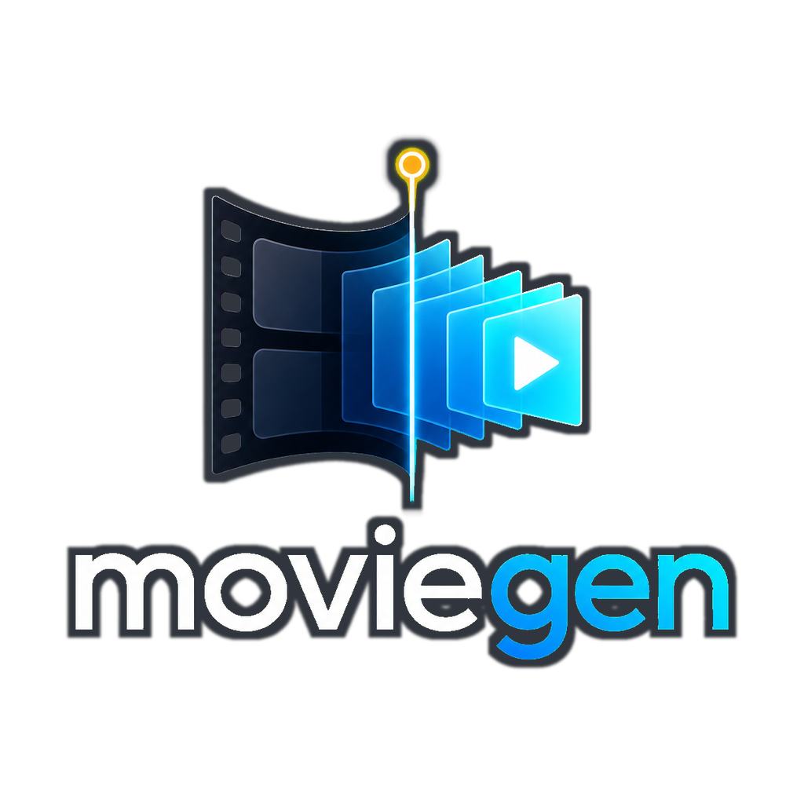
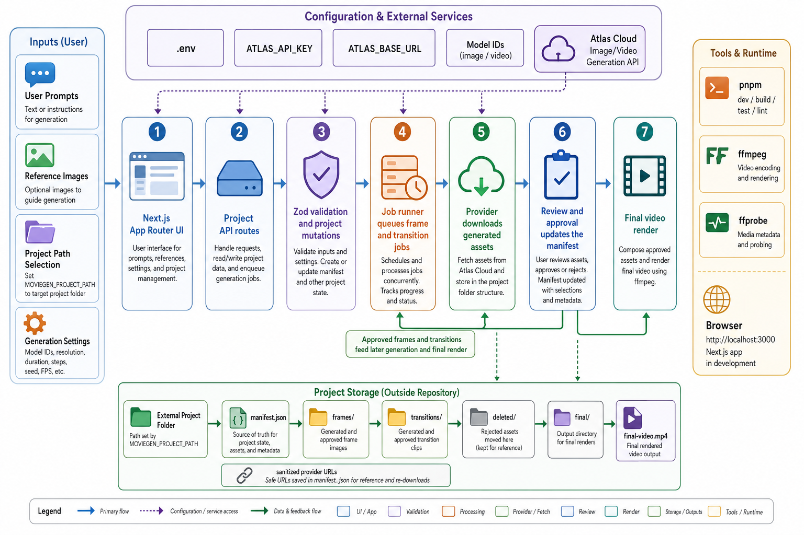

<p align="center">
  
  <br />
  <!-- repo-tagline:start -->
  <strong>🎬 Plan, generate, and render short frame-to-frame movies 🎞️</strong>
  <!-- repo-tagline:end -->
</p>

moviegen is a local Next.js workspace for planning and generating short frame-to-frame movie sequences. It lets you write frame prompts, attach reference images, generate still frames and transition clips through Atlas Cloud, review versions, approve the best assets, and render a final MP4.

Projects are stored in a folder outside this repository. The app keeps a JSON manifest plus generated media assets in that project folder, while the repo stays focused on the editor, API routes, generation pipeline, and tests.

## Install

```bash
pnpm install
pnpm dev --port auto
```

To open a project automatically on startup, set `MOVIEGEN_PROJECT_PATH` to an absolute path outside this repository:

```bash
MOVIEGEN_PROJECT_PATH=/absolute/path/to/moviegen-project pnpm dev --port auto
```

## Commands

```bash
pnpm dev --port auto
pnpm build           # build the production app
pnpm production:check # require clean, current main with successful exact-commit CI
pnpm build:production # exact-commit CI gate, then build using configured environment
pnpm start --port auto # run the built app locally
pnpm start:production # CI gate, then run the matching approved Production build
pnpm lint            # run ESLint
pnpm test            # run Vitest tests
pnpm check:no-media  # check git history for committed media files
```

## Notes

Dependency security pins `minimatch` 11.0.1 and its nonrecursive matcher 1.0.1. Small pnpm patches retain legacy CommonJS/ESM matcher imports and migrate the import lint rule to `Minimatch.match`; the removed regex engine is not restored. The seven-day package hold and existing exception are retained; the new exceptions cover only these exact user-approved versions.

- Production remains local, with persistent project folders and ffmpeg. GitHub CI gates secret scanning, dependency audit, tests, lint, type checking and a credential-free build. Zod 4.6.7 addresses the collection-validation advisory while preserving the seven-day package-age rule. The explicit Production commands check the exact current GitHub `main` commit and successful CI; starting Production also requires the matching approved build artifact. Push reviewed changes and wait for CI, then run the commands above locally. Direct Vercel Git builds are disabled; no Vercel Production workflow or deployment token is installed.
- Local Production checks require Git and the GitHub CLI (`gh`) signed in with repository access. Configure Atlas credentials separately in the server environment.

- Use `pnpm`; this repo includes `pnpm-lock.yaml` and `pnpm-workspace.yaml`.
- `ATLAS_BASE_URL`, model IDs, Seedance defaults, `FFMPEG_PATH`, and `FFPROBE_PATH` can be overridden with environment variables.
- `NEXT_PUBLIC_GA_MEASUREMENT_ID` enables GA4 page-view tracking when configured.
- Project paths must be absolute and outside the app workspace.
- Project folders contain `manifest.json`, `frames/`, `transitions/`, `deleted/`, and final renders under `final/`.
- Final video rendering uses `ffmpeg`; media probing uses `ffprobe`.
- Generated media should not be committed. `architecture.png` is the only tracked PNG allowed by the media guard.

## Architecture



## License


Moviegen requires persistent project folders and local ffmpeg/ffprobe. Its existing Vercel project does not provide that runtime; this migration does not deploy the editor to an ephemeral filesystem.

[MIT License](LICENSE).
