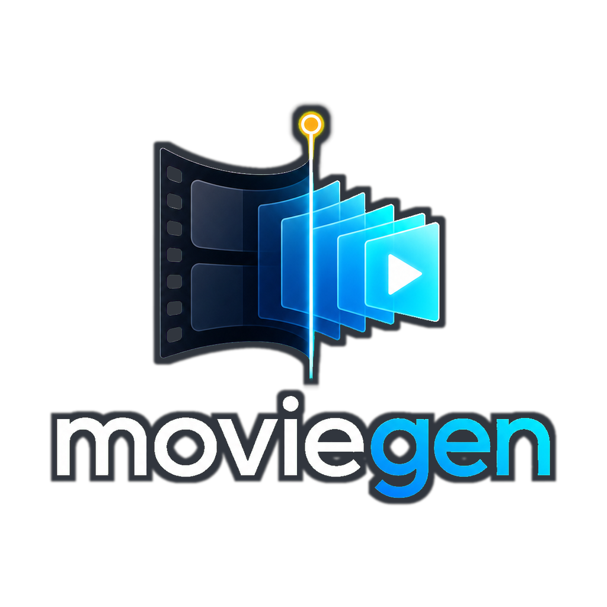

<p align="center">
  
  <br />
  <!-- repo-tagline:start -->
  <strong>🎬 Plan, generate, and render short frame-to-frame movies 🎞️</strong>
  <!-- repo-tagline:end -->
</p>

Moviegen is a local workspace for making short videos frame by frame.
Write prompts, attach references, review generated frames and transitions,
and render selected assets to MP4.

## Run locally

From a checkout:

```bash
pnpm install --frozen-lockfile
pnpm dev --port auto
```

Open the printed URL. Open or create a project in an absolute path outside
the repository. Its manifest and media stay in that folder. Generation uses
Atlas Cloud with configured server credentials. Final rendering requires
`ffmpeg` and `ffprobe`.

See the [development guide](docs/development.md) for environment settings,
project layout, checks, and the local production workflow.

## License

[MIT License](LICENSE).
